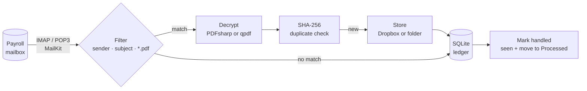

# 📬 🔓 payslip-archiver

[](https://github.com/guibranco/payslip-archiver/actions/workflows/build.yml)
[](https://github.com/guibranco/payslip-archiver/actions/workflows/deploy.yml)
[](LICENSE)
[](https://dotnet.microsoft.com/)

Watches a payroll mailbox, strips the password from payslip PDFs and archives clean copies to Dropbox.

Payroll providers e-mail payslips as password-protected PDFs, always with the same password. That is
fine for transit and useless for an archive: every time you need a slip you are typing the password again.
This small .NET service polls a dedicated IMAP (or POP3) mailbox, picks out the payslip e-mails, removes
the password from each PDF and files the result under `/<year>/<yyyy-MM> Payslip.pdf` in Dropbox — or in
any local folder you point it at.

## How it works



Each cycle:

1. opens one mailbox session and lists candidate messages (unread, from the configured sender);
2. skips anything the **ledger** already knows — archived, ignored, or past its retry budget;
3. fetches the rest, decrypts every matching PDF attachment and hashes the result;
4. uploads each new document (Dropbox never overwrites — a name clash gets auto-renamed);
5. records the outcome in the ledger **before** flagging the e-mail as seen / moving it to `Processed`.

That ordering is what makes the whole thing idempotent: a crash between upload and flagging means the
next cycle sees the ledger entry and skips the upload. A bad message (wrong password, corrupt file) is
retried up to `Pipeline:MaxAttempts` times and then left alone with a warning in the log, instead of
blocking everything behind it.

## Quick start (local, no Dropbox)

```bash
git clone https://github.com/guibranco/payslip-archiver && cd payslip-archiver

# secrets stay out of appsettings.json
cd src/PayslipArchiver.Worker
dotnet user-secrets set "Mailbox:Host"     "mail.example.com"
dotnet user-secrets set "Mailbox:Username" "payslips@example.com"
dotnet user-secrets set "Mailbox:Password" "…"
dotnet user-secrets set "Pdf:Password"     "…"
dotnet user-secrets set "Filter:FromContains" "@payroll-provider.example"

# Development profile: runs once, writes to ./archive, keeps the ledger in ./data
DOTNET_ENVIRONMENT=Development dotnet run
```

Check `./archive/<year>/…` and the log output, then move on to Dropbox.

## Dropbox setup (once)

1. Create an app at <https://www.dropbox.com/developers/apps>: *Scoped access* → **App folder**
   (the archive then lives in `/Apps/<your app name>` and the token can see nothing else).
2. On the *Permissions* tab tick `files.content.write` and `files.metadata.read`.
3. Put the app key in config and run the one-off authorisation:

   ```bash
   dotnet user-secrets set "Dropbox:AppKey" "…"
   dotnet run -- authorize-dropbox
   ```

   It prints a URL; approve the app in the browser, paste the code back, and it prints a **refresh
   token**. No app secret is needed — the PKCE flow is used when `Dropbox:AppSecret` is empty.
4. Store it:

   ```bash
   dotnet user-secrets set "Dropbox:RefreshToken" "…"
   ```

With `Archive:Provider=Dropbox` (the default) the service now uploads straight to the app folder.
If the Dropbox desktop client runs on the same machine you can skip all of this and use
`Archive:Provider=FileSystem` with `Archive:Directory` pointing inside your synced folder.

## Configuration

Everything is plain `IConfiguration`: `appsettings.json`, user secrets, or environment variables
with `__` as the separator (`Mailbox__Password`). The service validates required settings at startup
and refuses to start with a clear message when something is missing.

| Section · key | Default | Notes |
|---|---|---|
| `Mailbox:Protocol` | `Imap` | `Imap` or `Pop3`. POP3 needs server UIDL support and cannot flag messages, so the ledger does all the de-duplication. |
| `Mailbox:Host` / `Port` / `UseSsl` | – / `993` / `true` | `UseSsl=false` means STARTTLS, and it is required — the connection is refused rather than downgraded to plaintext. |
| `Mailbox:Username` / `Password` | – | Use an app password where the provider offers one. |
| `Mailbox:Folder` | `INBOX` | IMAP folder to watch. |
| `Mailbox:ProcessedFolder` | `Processed` | IMAP: handled messages are moved here (created on demand). Empty = leave in place. |
| `Mailbox:OnlyUnseen` | `true` | IMAP: only unread messages are candidates. |
| `Mailbox:DeleteAfterProcessing` | `false` | POP3: delete handled messages from the server. |
| `Filter:FromContains` | – | Case-insensitive substring of the sender, e.g. `@payroll-provider.example`. |
| `Filter:SubjectContains` | – | Case-insensitive substring of the subject. |
| `Filter:AttachmentPattern` | `*.pdf` | Glob on the attachment name. Only PDFs are ever considered. |
| `Pdf:Password` | – | **Required.** The provider's password. |
| `Pdf:Engine` | `PdfSharp` | `PdfSharp` (in-process) or `Qpdf` (shells out to `qpdf`, handles anything). |
| `Naming:PathTemplate` | `/{year}/{period} Payslip.pdf` | Tokens: `{year}` `{month}` `{period}` (`yyyy-MM`) `{original}` `{ext}`. |
| `Naming:PeriodOffsetMonths` | `0` | Used only when no period can be read from the file name or subject: shifts the e-mail's month (e.g. `-1` when slips arrive early the next month). |
| `Archive:Provider` | `Dropbox` | `Dropbox` or `FileSystem`. |
| `Archive:Directory` | `archive` | Root folder for `FileSystem`. |
| `Dropbox:AppKey` / `RefreshToken` | – | **Required** for the Dropbox provider. `AppSecret` is optional (PKCE). |
| `Dropbox:RootPath` | `/` | Folder under which the template is rendered. |
| `Ledger:Path` | `data/ledger.db` | SQLite file; created on first run. |
| `Pipeline:MaxMessagesPerCycle` | `50` | Backlog is drained gradually. |
| `Pipeline:MaxAttempts` | `5` | Retry budget per message. |
| `Schedule:Interval` | `00:30:00` | Time between cycles (the first runs at start-up). |
| `Schedule:RunOnce` | `false` | Run one cycle and exit (exit code 1 if anything failed) — for cron / systemd timers. |
| `Heartbeat:PingUrl` | – | Healthchecks.io ping URL; `/start` and `/fail` are appended automatically. Empty disables it. |

### Pay period detection

The month a slip is filed under is read, in order, from the attachment name, the subject, and finally
the e-mail date. Recognised shapes include `2026-10`, `202610`, `2026-10-15`, `10/2026`, `Oct 2026`,
`October2026` and `2026 October`. Anything else falls back to the e-mail date plus
`Naming:PeriodOffsetMonths`.

## Deploying

Every push to `main` is built, tested, shipped to the host as a systemd service and tagged as a GitHub
release by [`deploy.yml`](.github/workflows/deploy.yml). Pull requests run [`build.yml`](.github/workflows/build.yml)
(build, tests, coverage summary on the PR). Versions come from GitVersion: put `+semver: minor` or
`+semver: major` in the merge commit to bump more than a patch.

### One-time host setup

```bash
# a dedicated deploy user whose only job is to run install.sh
sudo useradd --create-home --shell /bin/bash deploy
sudo install -d -m 700 -o deploy -g deploy /home/deploy/.ssh
echo "<public key of SSH_PRIVATE_KEY>" | sudo tee /home/deploy/.ssh/authorized_keys
sudo chmod 600 /home/deploy/.ssh/authorized_keys && sudo chown deploy:deploy /home/deploy/.ssh/authorized_keys
# passwordless sudo for the install script only (the path is what the workflow invokes)
echo 'deploy ALL=(root) NOPASSWD: /home/deploy/payslip-archiver-deploy/release/install.sh' | sudo tee /etc/sudoers.d/payslip-archiver
sudo chmod 440 /etc/sudoers.d/payslip-archiver
```

### Repository secrets

| Secret | Required | Becomes |
|---|---|---|
| `SSH_HOST`, `SSH_USER`, `SSH_PRIVATE_KEY` | yes | how the workflow reaches the host (`SSH_PORT` optional, default 22) |
| `MAILBOX_HOST`, `MAILBOX_USERNAME`, `MAILBOX_PASSWORD` | yes | `Mailbox:*` (`MAILBOX_PORT`, `MAILBOX_PROTOCOL` optional: 993 / `Imap`) |
| `FILTER_FROM_CONTAINS`, `FILTER_SUBJECT_CONTAINS` | no | `Filter:*` |
| `PDF_PASSWORD` | yes | `Pdf:Password` |
| `DROPBOX_APP_KEY`, `DROPBOX_REFRESH_TOKEN` | yes | `Dropbox:*` (`DROPBOX_ROOT_PATH` optional, default `/`) |
| `HEARTBEAT_PING_URL` | no | `Heartbeat:PingUrl` |

The workflow renders them into `/etc/payslip-archiver/env` (root-only, read by systemd before the
service drops to the `payslip` user), uploads the self-contained build and runs
[`deploy/scripts/install.sh`](deploy/scripts/install.sh), which creates the service user and
directories, stages the release under `/opt/payslip-archiver/releases/<stamp>`, swaps the
`/opt/payslip-archiver/bin` symlink, (re)starts the unit and keeps the last three releases for rollback.
The ledger lives in `/var/lib/payslip-archiver` and survives upgrades.

**Manual install** follows the same path — see the comment block at the top of
[`deploy/systemd/payslip-archiver.service`](deploy/systemd/payslip-archiver.service). On an LXC target
drop `ProtectSystem=strict` and `PrivateTmp=true` from the unit first.

**Docker.** `deploy/docker-compose.yml` builds the image and keeps the ledger in a named volume, for
hosts where a container is preferable to a unit:

```bash
cp deploy/systemd/payslip-archiver.env deploy/.env   # fill in the secrets
docker compose -f deploy/docker-compose.yml up -d
```

**Cron instead of a daemon.** Set `Schedule__RunOnce=true` and let cron or a systemd timer invoke
the binary; the exit code tells the scheduler whether the cycle was clean.

## Project layout

```
src/
  PayslipArchiver.Domain          pure model: messages, attachments, pay periods, path template
  PayslipArchiver.Application     the archive use case, message filter, ports (interfaces), options
  PayslipArchiver.Infrastructure  MailKit (IMAP/POP3), PDFsharp + qpdf, Dropbox + file system, SQLite, Healthchecks.io
  PayslipArchiver.Worker          host: BackgroundService + PeriodicTimer, systemd integration, authorize-dropbox command
tests/
  PayslipArchiver.Domain.Tests
  PayslipArchiver.Application.Tests   pipeline behaviour with NSubstitute fakes
  PayslipArchiver.Infrastructure.Tests  real encrypted PDF fixtures (RC4, AES-128, AES-256), SQLite, MIME mapping
deploy/                            systemd unit + env template, install.sh, docker-compose
scripts/make-fixtures.sh           regenerates the encrypted test PDFs with qpdf
.github/workflows/                 build.yml (PRs: build, test, coverage) · deploy.yml (main: release + deploy to the host)
```

### PDFsharp and the licence

Payroll providers hand out only the *user* password. PDFsharp refuses to open such a document for
modification, so the decryptor opens it in *Import* mode and copies the pages into a brand-new,
unencrypted document instead — content and resources come along, the security handler does not.

PDFsharp 6.5+ is dual-licensed (AGPL-3.0 or commercial) and refuses to run until a licence is declared;
this project declares the AGPL one (`PdfSharpLicense.SetAgplLicense()`), which is why the project itself
is distributed under the **AGPL-3.0** as well. If you fork it for something you cannot release under the
AGPL, either buy a PDFsharp licence or switch the engine: `Pdf:Engine=Qpdf` shells out to
[qpdf](https://qpdf.sourceforge.io/) (Apache-2.0) behind the same `IPdfDecryptor` port.

## Development

```bash
dotnet build          # warnings are errors; analyzers at latest-recommended
dotnet test           # the qpdf tests skip themselves when qpdf is not installed
scripts/make-fixtures.sh   # only if you change the test PDFs (needs qpdf + python3)
```

Commits that add a feature carry `+semver: minor` in the message; GitVersion stamps the build.

## License

[GNU Affero General Public License v3.0](LICENSE) © Guilherme Branco Stracini

In short: you may use, modify and redistribute this software, but any distributed or network-served
derivative must be released under the same licence with its source available. See `LICENSE` for the
full terms.
